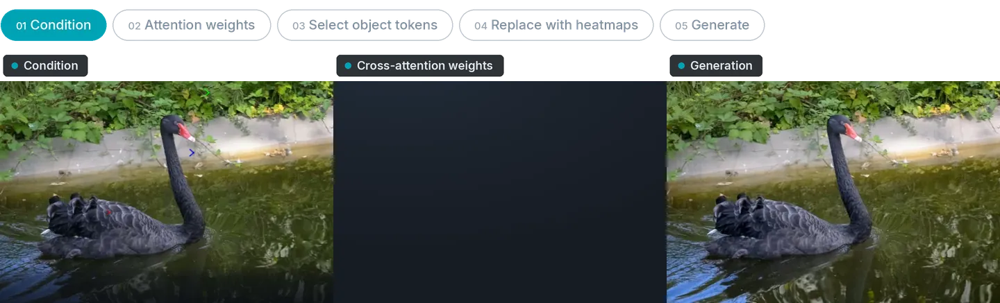
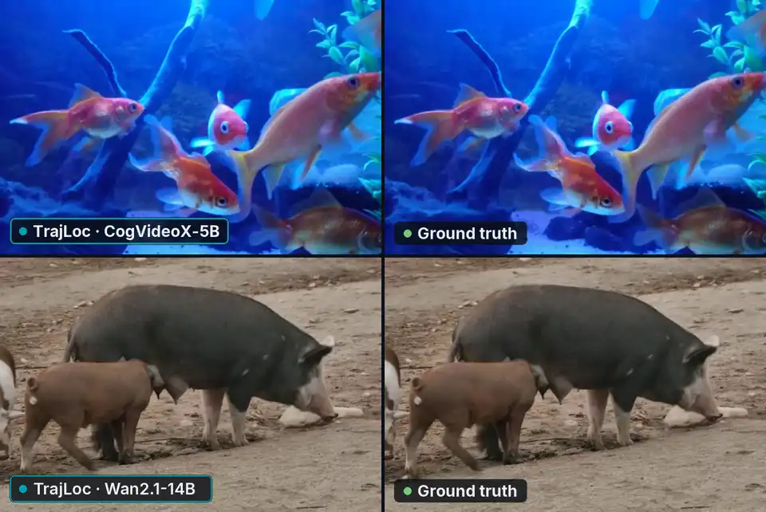
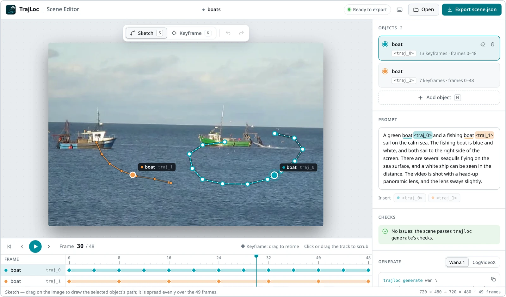

<a href="https://sela-omer.github.io/traj-loc/"></a>

<p align="center">
  <a href="https://arxiv.org/abs/2607.00861"></a>
  <a href="https://sela-omer.github.io/traj-loc/"></a>
  <a href="#models"></a>
  <a href="https://neurips.cc/"></a>
</p>

<p></p>

Given a first frame and a path for each object, TrajLoc generates a video in which every object follows
its own path, even in crowded scenes where paths cross. Each object gets its own text token, and in every
transformer block, that token's attention is replaced by a Gaussian at the object's target location, which
locks each trajectory to the right object.

## Results

TrajLoc on CogVideoX-5B (top) and Wan2.1-14B (bottom), against the ground truth and prior methods.



## Models

| Model | Base model | Trained on | Weights |
|:--|:--|:--|:--|
| **TrajLoc-CogVideoX-5B-I2V** | [CogVideoX-5B-I2V](https://huggingface.co/zai-org/CogVideoX-5b-I2V) | SA-V, 28,500 steps | [Hugging Face](https://huggingface.co/Omer-Sela/TrajLoc-CogVideoX-5B-I2V) |
| **TrajLoc-Wan2.1-I2V-14B-480P** | [Wan2.1-I2V-14B-480P](https://huggingface.co/Wan-AI/Wan2.1-I2V-14B-480P) | SA-V, 49,000 steps | [Hugging Face](https://huggingface.co/Omer-Sela/TrajLoc-Wan2.1-I2V-14B-480P) |

## Get started

### 1. Install

```sh
git clone --recursive https://github.com/Sela-Omer/traj-loc trajloc && cd trajloc
scripts/env/install.sh && source .venv/bin/activate
```

Requires Linux, an NVIDIA driver for CUDA 12.4, and [uv](https://docs.astral.sh/uv/getting-started/installation/)
(`curl -LsSf https://astral.sh/uv/install.sh | sh`).

### 2. Generate a video

```sh
trajloc generate wan --image assets/examples/pigs/image.png \
    --scene assets/examples/pigs/scene.json --run_name pigs
```

[`assets/examples`](assets/examples) holds four scenes from the project page, each a first frame and its
`scene.json`: `boats`, `motorbike_trick`, `goldfish` and `pigs`. Use `cogvideox` for the other model,
and `--checkpoint` for one of your own.

To animate your own image, draw its scene in [`tools/scene_editor.html`](tools/scene_editor.html): open it
in a browser (offline, nothing to install), draw each object's path on the first frame, write the
prompt with each object's `<traj_i>` after its noun, and export `scene.json`.

<p>
<picture>
  <source media="(prefers-color-scheme: dark)" srcset="assets/readme/scene_editor_dark.webp"/>
  
</picture>
</p>

## Benchmark inference

### 1. Prepare the benchmarks

```sh
scripts/download_data.sh movebench && GPUS=0,1,2,3 scripts/prepare_data.sh movebench
scripts/download_data.sh magicbench && GPUS=0,1,2,3 scripts/prepare_data.sh magicbench
```

[MoveBench](https://huggingface.co/datasets/Ruihang/MoveBench) and
[MagicBench](https://huggingface.co/datasets/quanhaol/MagicBench) download from Hugging Face.

### 2. Generate

```sh
trajloc infer wan --run_name wan
trajloc infer cogvideox --run_name cogvideox
```

Every MoveBench and MagicBench clip is generated with the released model into
`runs/infer/<backbone>/<run_name>/`. To split a run across GPUs, start one process per GPU with
`--device cuda:<i> --shard <i> --num_shards <n>`.

## Training

### 1. Prepare SA-V

```sh
SAV_LINKS=<sa-v links file> scripts/download_data.sh sav
GPUS=0,1,2,3 scripts/prepare_data.sh sav
```

SA-V requires accepting Meta's [license](https://ai.meta.com/datasets/segment-anything-video-downloads/);
Meta then sends the links file to pass as `SAV_LINKS`. Its
[SVG2](https://huggingface.co/datasets/UWGZQ/Synthetic_Visual_Genome2) scene graphs download from Hugging
Face.

### 2. Train

```sh
trajloc train cogvideox --config configs/cogvideox.yaml --run_name my_cogvideox
trajloc train wan --config configs/wan.yaml --run_name my_wan
```

Each command trains on one GPU with the released model's config. The released models are the
checkpoints at steps 28,500 (CogVideoX) and 49,000 (Wan). Checkpoints are written to
`runs/train/<backbone>/<run_name>/checkpoints/checkpoint-<step>/`; pass one to `trajloc infer` or
`trajloc generate` with `--checkpoint`.

## Citation

```bibtex
@inproceedings{sela2026trajloc,
  title         = {TrajLoc: Trajectory-Attention Localization for
                   Multi-Object Motion Control},
  author        = {Sela, Omer and Huberman-Spiegelglas, Inbar and
                   Rotman, Michael and Benaim, Sagie and Ben-Cohen, Avi},
  booktitle     = {Advances in Neural Information Processing Systems},
  year          = {2026},
  note          = {To appear},
  eprint        = {2607.00861},
  archivePrefix = {arXiv},
  primaryClass  = {cs.CV},
  url           = {https://arxiv.org/abs/2607.00861}
}
```

## License

The code and the TrajLoc weights are released under the [Apache License 2.0](LICENSE).
TrajLoc-CogVideoX-5B-I2V is also subject to the
[CogVideoX License](https://huggingface.co/zai-org/CogVideoX-5b-I2V/blob/main/LICENSE), and data
preparation uses [CoTracker3](https://github.com/facebookresearch/co-tracker)
([CC BY-NC 4.0](https://creativecommons.org/licenses/by-nc/4.0/)). Third-party assets in this
repository are listed in [NOTICE](NOTICE).

## Acknowledgements

TrajLoc builds on [CogVideoX](https://github.com/zai-org/CogVideo), [Wan2.1](https://github.com/Wan-Video/Wan2.1),
[DiffSynth-Studio](https://github.com/modelscope/DiffSynth-Studio), [SAM 2](https://github.com/facebookresearch/sam2),
[CoTracker](https://github.com/facebookresearch/co-tracker) and
[Qwen2.5-VL](https://huggingface.co/Qwen/Qwen2.5-VL-7B-Instruct).
The models are trained on [SA-V](https://ai.meta.com/datasets/segment-anything-video/), with
[SVG2](https://huggingface.co/datasets/UWGZQ/Synthetic_Visual_Genome2)'s scene graphs, and evaluated on
[MoveBench](https://huggingface.co/datasets/Ruihang/MoveBench) and
[MagicBench](https://huggingface.co/datasets/quanhaol/MagicBench). The example scenes are first frames and
tracks from [DAVIS](https://davischallenge.org/) and [MoveBench](https://huggingface.co/datasets/Ruihang/MoveBench).
